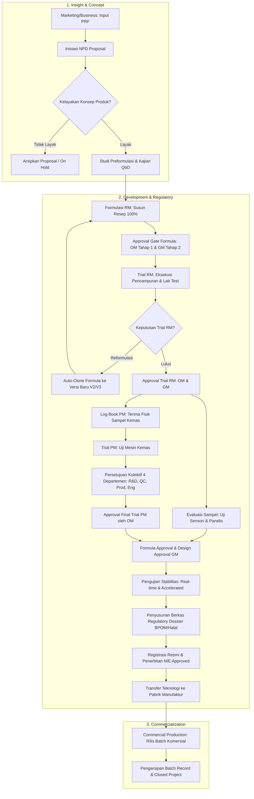
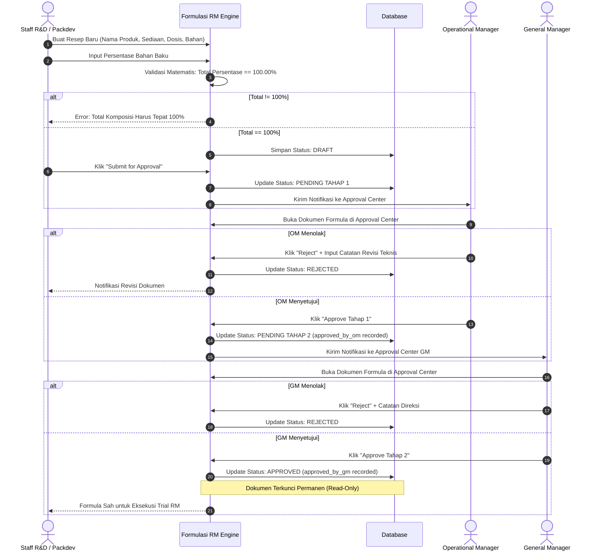
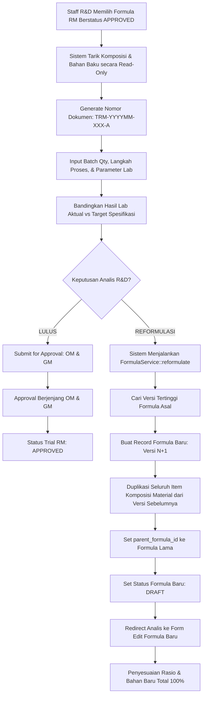
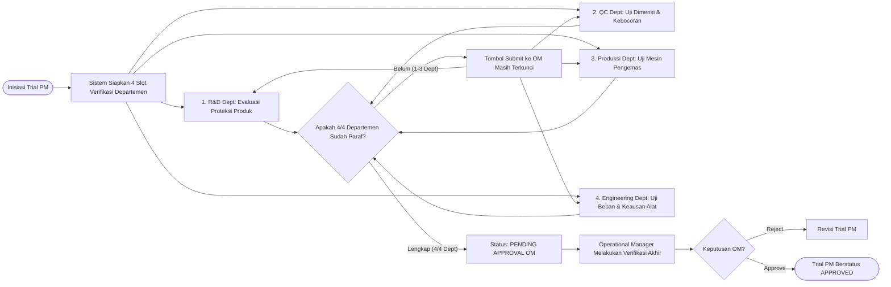
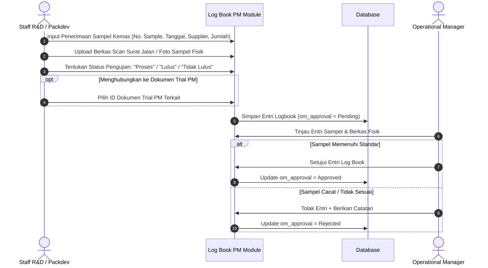
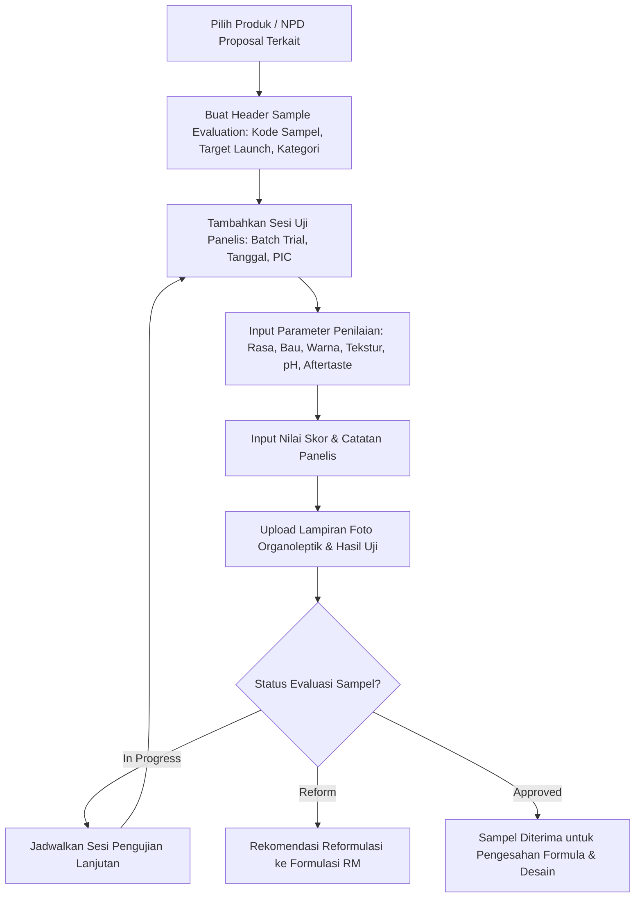
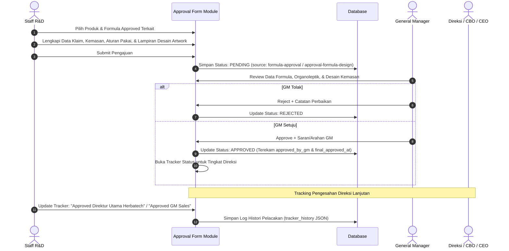

# Dokumentasi Sistem: Alur Data (Data Flow) & Struktur Menu R&D
## R&D Management System — PT Herbatech Innopharma Industry

Dokumen ini merupakan panduan arsitektur sistem, peta menu komprehensif, alur data (*data flow*), matriks hak akses peran (*Role-Based Access Control*), dan aturan bisnis (*business rules*) untuk aplikasi **R&D Management System**.

---

## 📑 Daftar Isi
1. [Ringkasan & Arsitektur Sistem](#1-ringkasan--arsitektur-sistem)
2. [Peta Struktur Menu & Navigasi (Sitemap)](#2-peta-struktur-menu--navigasi-sitemap)
3. [Matriks Peran Pengguna & Hak Akses (RBAC)](#3-matriks-peran-pengguna--hak-akses-rbac)
4. [Alur Data End-to-End (Data Flow Diagrams)](#4-alur-data-end-to-end-data-flow-diagrams)
   - [A. End-to-End NPD Data Lifecycle (Fase 1 s/d Fase 3)](#a-end-to-end-npd-data-lifecycle)
   - [B. Alur Data Formulasi RM & Multi-Stage Approval Gate](#b-alur-data-formulasi-rm--multi-stage-approval-gate)
   - [C. Alur Data Trial RM & Mekanisme Auto-Clone Reformulasi](#c-alur-data-trial-rm--mekanisme-auto-clone-reformulasi)
   - [D. Alur Data Trial PM & Konsensus 4 Departemen](#d-alur-data-trial-pm--konsensus-4-departemen)
   - [E. Alur Data Log Book PM (Penerimaan Sampel Kemas)](#e-alur-data-log-book-pm)
   - [F. Alur Data Evaluasi Sampel (Sample Evaluation Panel Testing)](#f-alur-data-evaluasi-sampel)
   - [G. Alur Data Formula & Design Approval](#g-alur-data-formula--design-approval)
   - [H. Alur Manajemen Dokumen Regulasi & Produksi Komersial (Dossier & DMS)](#h-alur-manajemen-dokumen-regulasi--produksi-komersial)
5. [Skema Penomoran Dokumen Otomatis](#5-skema-penomoran-dokumen-otomatis)
6. [Aturan Validasi & Integritas Data (Business Rules)](#6-aturan-validasi--integritas-data-business-rules)
7. [Panduan Operasional Menu Sistem](#7-panduan-operasional-menu-sistem)

---

## 1. Ringkasan & Arsitektur Sistem

Aplikasi **R&D Management System** dirancang untuk mendigitalkan seluruh tahapan siklus hidup riset dan pengembangan produk herbal farmasi pada **PT Herbatech Innopharma Industry**, mulai dari inisiasi ide produk (*concept*), formulasi bahan baku (*raw material*), pengujian bahan kemas (*packaging material*), uji stabilitas, pemenuhan berkas regulasi BPOM, transfer teknologi manufaktur, hingga tahap komersialisasi batch industri.

### Komponen Teknologi Utama
* **Backend:** Laravel 11/12 (PHP 8.2+) dengan arsitektur Service-Repository Pattern.
* **Frontend:** Laravel Blade, Tailwind CSS, Alpine.js, TomSelect.
* **Keamanan & Otorisasi:** Spatie Laravel-Permission (Role-Based Access Control) & Laravel Gate Policies.
* **Audit Trail:** Spatie Laravel-Activitylog (pencatatan jejak mutasi data dan otentikasi).
* **Document Engine:** DomPDF (cetak resmi & digital signatures), ZipArchive, Maatwebsite Excel.

---

## 2. Peta Struktur Menu & Navigasi (Sitemap)

Menu aplikasi dikelompokkan secara logis berdasarkan hierarki peran pengguna dan alur kerja NPD (*New Product Development*):

```
R&D MANAGEMENT SYSTEM
│
├── 📊 DASHBOARD
│   └── Timeline Dashboard (/timeline)
│       ├── KPI Metrics (Total Items, Approved, Pending, Rejected, Draft, Pipeline %)
│       ├── Module Progress Grid (13 Modul R&D)
│       ├── Interactive Filter & Project Search
│       ├── Action Required / Pending Task Cards (berbasis Role)
│       ├── Tim Audit & Recent Activity Feed
│       └── Beban Kerja Analis / Staff Workload (khusus Manager & GM)
│
├── 🚀 MODUL UTAMA (NPD WORKFLOW)
│   │
│   ├── 📁 1. Insight & Concept
│   │   ├── 📝 PRF (Product Request Form) (/prfs)
│   │   │   ├── Registrasi Formulir Permintaan Produk
│   │   │   ├── Target Pasar, Konsep Produk, Estimasi Harga
│   │   │   └── Upload Dokumen Pendukung & Studi Awal
│   │   └── 📋 NPD Proposal (/npd-proposals)
│   │       ├── Pembuatan Proposal Inisiasi Proyek R&D
│   │       ├── Pelacakan Status Proyek (Draft, On Track, In Progress, On Hold, Delayed, Completed)
│   │       └── Manajemen Dokumen Brief & Riset Kompetitor
│   │
│   ├── 🔬 2. Development & Regulatory
│   │   ├── 🎯 QbD (Quality by Design) (/qbds)
│   │   │   ├── Kajian Mutu Sejak Desain (Quality Target Product Profile)
│   │   │   └── Berkas Karakterisasi Produk & Analisis Risiko Mutu
│   │   │
│   │   ├── 🧪 Formulation Development (Menu Accordion)
│   │   │   ├── Formula RM (/formulas)
│   │   │   │   ├── Draf Resep & Komposisi Rasio Bahan Baku (Wajib 100%)
│   │   │   │   ├── Perhitungan Dosis, HPP, & Target Kemasan
│   │   │   │   ├── Pengajuan Approval Berjenjang (OM & GM)
│   │   │   │   └── Fitur Reformulasi Otomatis (Auto-Clone Versioning)
│   │   │   ├── Trial RM (/trial-rms)
│   │   │   │   ├── Pencatatan Uji Coba Laboratorium Pencampuran
│   │   │   │   ├── Uji Organoleptik & Fisika-Kimia (Target vs Aktual)
│   │   │   │   └── Keputusan Trial: "Lulus" atau "Reformulasi"
│   │   │   ├── Trial PM (/trial-pms)
│   │   │   │   ├── Pengujian Bahan Kemas pada Mesin Produksi
│   │   │   │   ├── Parameter Mesin, Kecepatan, Tekanan & Suhu Sealing
│   │   │   │   └── Verifikasi Kolektif 4 Departemen (R&D, QC, Produksi, Engineering)
│   │   │   └── Log Book PM (/logbook-pm)
│   │   │       ├── Buku Penerimaan Sampel Kemasan Fisik dari Supplier
│   │   │       ├── Status Pengujian Sampel (Proses, Lulus, Tidak Lulus)
│   │   │       └── Approval Penerimaan oleh Operational Manager
│   │   │
│   │   ├── 👥 Sample Evaluation (/sample-evaluations)
│   │   │   ├── Uji Sensori, Organoleptik & Panelis Produk
│   │   │   ├── Pencatatan Sesi Evaluasi Panelis (Trial Batch, Tanggal, PIC)
│   │   │   └── Penilaian Parameter (Rasa, Aroma, Tekstur, Penampilan, Aftertaste)
│   │   │
│   │   ├── 📑 Formula Approval (/formula-approvals)
│   │   │   ├── Lembar Resmi Pengesahan Formula Produk
│   │   │   ├── Matriks Tanda Tangan Stakeholder & Direksi
│   │   │   ├── Review & Approval oleh General Manager
│   │   │   └── Tracking Status Persetujuan Direktur Utama
│   │   │
│   │   ├── ⏳ Stability Test (/stability-tests)
│   │   │   ├── Perekaman Uji Stabilitas Produk (Real-Time & Accelerated)
│   │   │   └── Pengarsipan Sertifikat Analisis & Laporan Uji Berkala
│   │   │
│   │   ├── 🎨 Design Approval (/approval-formula-designs?type=Design)
│   │   │   ├── Verifikasi Desain Artwork & Kemasan Produk
│   │   │   ├── Pengarsipan File Master Desain Kemasan
│   │   │   └── Approval Desain oleh General Manager
│   │   │
│   │   ├── 🏛️ Regulatory Dossier (/regulatory-dossier)
│   │   │   ├── Document Management System (DMS) Berkas Registrasi BPOM / Halal
│   │   │   ├── Struktur Folder Hirarkis Tak Terbatas (Unlimited Nested Folders)
│   │   │   ├── Version Control Dokumen (Histori Revisi & Revert)
│   │   │   └── Fitur Export Paket Berkas (ZIP Archive) & Metadata (Excel)
│   │   │
│   │   ├── 🏭 Technology Transfer (/technology-transfers)
│   │   │   ├── Perekaman Dokumen Alih Teknologi dari Lab R&D ke Fasilitas Pabrik
│   │   │   └── Berkas Scale-Up Trial, Prosedur Tetap (SOP), & Validasi Proses
│   │   │
│   │   └── 📜 NIE Approved (/nie-approvals)
│   │       ├── Pencatatan Nomor Izin Edar Resmi (BPOM / Kemenkes)
│   │       └── Lampiran Sertifikat Asli & Masa Berlaku Izin Edar
│   │
│   └── 🏢 3. Commercialization
│       └── 📦 Commercial Production (/commercial-productions)
│           ├── DMS Folder Manajemen untuk Dokumen Produksi Skala Komersial
│           ├── Batch Record, Catatan Pengolahan Batch (CPB), & Catatan Pengemasan (CPK)
│           └── Manajemen Dokumen Rilis Batch Pasar
│
├── 🛡️ MANAJEMEN
│   └── ⚖️ Approval Center (/approval-center)
│       ├── Pusat Antrean Verifikasi Terpadu (Single Inbox)
│       ├── Badge Notifikasi Real-Time (Pending Tasks)
│       ├── Tab Formula RM (Pending Tahap 1 / Pending Tahap 2)
│       ├── Tab Trial RM (Pending Tahap 1 / Pending Tahap 2)
│       ├── Tab Trial PM (Pending OM setelah Konsensus 4 Dept)
│       ├── Tab Preformulation Studies (Pending Tahap 1 / Pending Tahap 2)
│       └── Tab Formula Approvals (Pending GM Review)
│
├── 🗄️ MASTER DATA (Superadmin & Staff R&D)
│   ├── 🌿 Data Master Material & Supplier (/materials)
│   │   ├── Master Bahan Baku (/materials) (Kode, Nama, Bentuk, Dokumen COA & MSDS)
│   │   ├── Master Supplier (/suppliers) (Nama, Kontak, Alamat, Status)
│   │   ├── Harga Bahan Pemasok (/material-suppliers) [FASE 2]
│   │   │   ├── Katalog Relasi Bahan Baku - Rekanan Pemasok
│   │   │   ├── Pembaruan Harga Acuan Aktif (Modal Update & Real-Time Diff)
│   │   │   └── Riwayat Perubahan Harga Bahan (Audit Trail & Price History Log)
│   │   └── Integrasi Procurement API (/procurement-prices) [FASE 4]
│   │       ├── Staging Feed Data PO & Harga Vendor dari Sistem Pengadaan
│   │       ├── Status Pemetaan (Unmapped, Mapped, Applied) & Pemetaan Manual
│   │       ├── Aksi 1-Klik Terapkan Harga ke Katalog R&D (Single & Batch Apply)
│   │       ├── Endpoint Inbound Webhook: POST /api/v1/procurement/prices
│   │       └── In-App API Sandbox / Live Tester
│   ├── 🏷️ Category (/product-categories)
│   │   └── Master Kategori Produk (Herbal, Suplemen, Kosmetik, Makanan/Minuman)
│   └── 💊 Nama Produk (/products)
│       └── Master Registrasi Entitas Produk
│
├── ⚙️ AKSES & SISTEM (Superadmin Only)
│   ├── 👤 Akses Kontrol (/users)
│   │   ├── Manajemen Akun Pengguna
│   │   ├── Penetapan Role (Staff R&D, Staff Packdev, OM, GM, Superadmin)
│   │   └── Reset Kata Sandi Pengguna
│   └── 🛠️ Pengaturan Sistem (/settings)
│       ├── Identitas Aplikasi (Nama Sistem, Nama Perusahaan)
│       ├── Branding Gambar (Logo Header, Logo Cetak PDF, Favicon)
│       ├── Tanda Tangan / Paraf Standar Departemen (Produksi, QC, Engineering)
│       ├── Integrasi API Procurement (URL Outbound, Secret Token, Toggle Auto-Apply)
│       └── Mode Pemeliharaan Sistem (Maintenance Mode & Broadcast Notice)
│
└── 👤 USER ACCOUNT
    ├── Profil Saya (/profile) (Ubah Profil, Ganti Password, Upload Spesimen Tanda Tangan)
    └── Logout (Keluar Sesi Aman)
```

---

## 3. Matriks Peran Pengguna & Hak Akses (RBAC)

Sistem menerapkan pemisahan tugas ketat (*Segregation of Duties*) untuk memastikan integritas data farmasi:

### Definisi Peran:
1. **Staff R&D:** Inisiator utama dokumen formulasi, riset laboratorium, uji sensori, dokumen registrasi, dan master bahan baku.
2. **Staff Packdev:** Spesialis pengembangan bahan kemas (*packaging development*), menangani pengujian trial kemasan, log book kemasan, dan approval desain.
3. **Operational Manager (OM):** Penilai teknis operasional. Bertindak sebagai **Approval Tahap 1** untuk Formulasi RM dan Trial RM, serta pemberi approval utama untuk Trial PM dan Log Book PM.
4. **General Manager (GM):** Pengambil keputusan tertinggi dan penjamin mutu komersial. Bertindak sebagai **Approval Tahap 2 (Final Gate)** untuk seluruh Formulasi RM, Trial RM, dan Formula Approval Form.
5. **Superadmin:** Pengelola sistem dengan akses *full bypass*, pengaturan akun, hak akses, dan konfigurasi aplikasi.

### Matriks Otorisasi Modul & Aksi:

| Modul & Fitur | Staff R&D | Staff Packdev | Operational Manager | General Manager | Superadmin |
| :--- | :---: | :---: | :---: | :---: | :---: |
| **Dashboard Timeline** | View (Own Data) | View (Own Data) | View (All Team Data) | View (All Team Data) | Full View |
| **PRF** | CRUD | CRUD | View | View | Full CRUD |
| **NPD Proposal** | CRUD | CRUD | View | View | Full CRUD |
| **QbD** | CRUD | CRUD | CRUD | CRUD | Full CRUD |
| **Formulasi RM (Create/Edit Draft)** | ✓ | ✓ | ✗ | ✗ | ✓ |
| **Formulasi RM (Approval Tahap 1)** | ✗ | ✗ | **✓ (OM)** | ✗ | ✓ |
| **Formulasi RM (Approval Tahap 2 Final)** | ✗ | ✗ | ✗ | **✓ (GM)** | ✓ |
| **Trial RM (Create & Input Hasil Lab)** | ✓ | ✓ | ✗ | ✗ | ✓ |
| **Trial RM (Approval Tahap 1 & 2)** | ✗ | ✗ | **Tahap 1 (OM)** | **Tahap 2 (GM)** | ✓ |
| **Trial PM (Create & Input Mesin)** | ✓ | ✓ | ✗ | ✗ | ✓ |
| **Trial PM (Paraf 4 Departemen)** | R&D Sign | Packdev Sign | Terkait Dept | Terkait Dept | Full Override |
| **Trial PM (Final Approval OM)** | ✗ | ✗ | **✓ (OM)** | ✗ | ✓ |
| **Log Book PM (Input Sampel Kemas)** | ✓ | ✓ | ✗ | ✗ | ✓ |
| **Log Book PM (Approval OM)** | ✗ | ✗ | **✓ (OM)** | ✗ | ✓ |
| **Sample Evaluation (Sensori/Panelis)** | CRUD | CRUD | View | View | Full CRUD |
| **Formula Approval Form (GM Decision)** | Create/Edit | Create/Edit | View | **✓ (Final GM)** | Full CRUD |
| **Stability Test** | CRUD | CRUD | View | View | Full CRUD |
| **Design Approval** | Create/Edit | Create/Edit | View | **✓ (Final GM)** | Full CRUD |
| **Regulatory Dossier (Folder & File)** | CRUD | CRUD | View | View | Full CRUD |
| **Technology Transfer** | CRUD | CRUD | View | View | Full CRUD |
| **NIE Approved** | CRUD | CRUD | CRUD | CRUD | Full CRUD |
| **Commercial Production (DMS)** | CRUD | CRUD | View | View | Full CRUD |
| **Approval Center Inbox** | ✗ | ✗ | ✓ (Queue Tahap 1) | ✓ (Queue Tahap 2) | ✓ (Semua Queue) |
| **Data Master (Material, Supplier, Category, Produk)** | CRUD | CRUD | View | View | Full CRUD |
| **Akses Kontrol (User Management)** | ✗ | ✗ | ✗ | ✗ | **✓ (Khusus Superadmin)** |
| **Pengaturan Sistem (Settings & Branding)** | ✗ | ✗ | ✗ | ✗ | **✓ (Khusus Superadmin)** |

---

## 4. Alur Data End-to-End (Data Flow Diagrams)

### A. End-to-End NPD Data Lifecycle

Diagram alir di bawah menggambarkan perjalanan data sebuah produk dari gagasan awal hingga produksi komersial:



---

### B. Alur Data Formulasi RM & Multi-Stage Approval Gate



---

### C. Alur Data Trial RM & Mekanisme Auto-Clone Reformulasi



---

### D. Alur Data Trial PM & Konsensus 4 Departemen



---

### E. Alur Data Log Book PM



---

### F. Alur Data Evaluasi Sampel (Sample Evaluation)



---

### G. Alur Data Formula & Design Approval



---

### H. Alur Manajemen Dokumen Regulasi & Produksi Komersial

```mermaid
flowchart TD
    subgraph DMS_ENGINE["Folder & Document Management System"]
        Root[Folder Root Kategori Produk / Modul] --> SubFolder[Subfolder Hirarki Tak Terbatas (parent_id)]
        SubFolder --> UploadDoc[Upload File: PDF, DOCX, XLSX, Gambar]
        UploadDoc --> MetaDoc[Simpan Metadata: Nama Asli, Ekstensi, Ukuran, Uploader]
        
        UploadDoc --> UpdateDoc[Pembaruan File Dokumen yang Sama]
        UpdateDoc --> ArchiveVer[Arsipkan File Lama ke DocumentVersion: Versi 1, 2, dst.]
        ArchiveVer --> ActiveVer[File Baru Menjadi Versi Aktif]
        
        SubFolder --> ActionDoc{Aksi Dokumen}
        ActionDoc --> Preview[Preview In-Browser PDF/Gambar]
        ActionDoc --> Download[Download File Dokumen]
        ActionDoc --> Move[Pindahkan ke Folder Lain]
        ActionDoc --> ExportZIP[Ekspor Seluruh Folder Sebagai Arsip .ZIP]
        ActionDoc --> ExportExcel[Ekspor Rekap Daftar Dokumen ke .XLSX]
    end
    
    UploadDoc & UpdateDoc & Move --> AuditLog[(Catat Riwayat Lengkap di RegulatoryAudit / CommercialAudit)]
```

---

## 5. Skema Penomoran Dokumen Otomatis

Setiap entitas dokumen riset memiliki pola nomor unik dengan aturan otomatis (*auto-increment*) yang terisolasi per bulan atau urutan:

| Modul | Pola Format Nomor | Contoh Nomor | Keterangan Aturan |
| :--- | :--- | :--- | :--- |
| **PRF** | `PRF-YYYYMM-XXX` | `PRF-202610-001` | Reset sequence setiap pergantian bulan kalender. |
| **NPD Proposal** | `NPD-YYYYMM-XXX` | `NPD-202610-001` | Berdasarkan bulan registrasi proposal. |
| **Formula RM (Resep Asli)** | `FRM-YYYYMM-XXX` | `FRM-202610-001` | Nomor resmi resep dasar produk. |
| **Formula RM (Reformulasi)** | `FRM-YYYYMM-XXX-V{n}` | `FRM-202610-001-V2` | Otomatis menambahkan suffix versi saat auto-clone. |
| **Trial RM** | `TRM-YYYYMM-XXX-{A,B..}` | `TRM-202610-001-A` | Menggunakan suffix huruf jika formula yang sama diuji coba berkali-kali. |
| **Trial PM** | `TPM-YYYYMM-XXX` | `TPM-202610-001` | Nomor pengujian bahan kemas mesin. |
| **Log Book PM** | `LPM-YYYYMM-XXX` | `LPM-202610-001` | Nomor registrasi penerimaan sampel fisik. |
| **Sample Evaluation** | `SE-YYYYMM-XXX` | `SE-202610-001` | Kode registrasi sesi pengujian organoleptik. |

---

## 6. Aturan Validasi & Integritas Data (Business Rules)

Untuk menjamin kepatuhan Cara Pembuatan Obat Tradisional yang Baik (CPOTB) dan Good Laboratory Practice (GLP), sistem menerapkan aturan berikut:

1. **Aturan Presisi Komposisi 100%:**
   - Total persentase bahan baku dalam Formula RM wajib bernilai tepat `100.00%` (toleransi floating-point `100.01%`). Tombol submit dinonaktifkan jika total persentase belum 100%.
2. **Kemandirian Versi Reformulasi (Data Immutability):**
   - Formula yang telah berstatus `Approved` tidak boleh diedit atau dihapus.
   - Perubahan hanya dapat dilakukan melalui mekanisme **Reformulasi (Auto-Clone)**, yang menghasilkan draf baru berstatus `Draft` dengan tautan ke `parent_formula_id`.
3. **Syarat Integritas Uji Trial RM:**
   - Form pembuatan Trial RM hanya mengizinkan pemilihan dari daftar Formula RM yang telah berstatus `Approved`.
4. **Konsensus Mutlak 4 Departemen Trial PM:**
   - Dokumen Trial PM tidak dapat diajukan kepada Operational Manager sebelum keempat departemen (R&D, QC, Produksi, Engineering) mengisi persetujuan dan catatan.
5. **Jejak Audit Otomatis (Audit Trail):**
   - Setiap mutasi status persetujuan, revisi berkas DMS, atau perubahan data login secara otomatis dicatat ke dalam tabel `activity_log` dengan rincian *causer*, *properties before-after*, dan alamat IP pengguna.

---

## 7. Panduan Operasional Menu Sistem

### 1. Dashboard (Timeline View)
* Digunakan sebagai ruang kerja harian seluruh personil R&D.
* **Staff:** Memantau dokumen yang sedang aktif, dokumen yang perlu direvisi pasca-penolakan, dan dokumen yang sedang menunggu persetujuan manager.
* **Manager & GM:** Memantau antrean persetujuan, progres pipa riset (*pipeline %*), serta beban kerja analis.

### 2. Modul Formulasi RM
* **Membuat Formula:** Klik *Tambah Formula*, masukkan nama produk, bentuk sediaan, target dosis sachet, dan pilih bahan baku dari master data. Pastikan indikator total rasio berwarna hijau (100%).
* **Submit Approval:** Klik *Submit for Approval*. Dokumen berpindah ke Approval Center OM.
* **Cetak Lembar Formula:** Klik ikon *Print* untuk menghasilkan dokumen PDF berstandar format pabrik dengan slot tanda tangan dan header resmi.

### 3. Modul Trial RM
* **Inisiasi Pengujian:** Klik *Tambah Trial RM*, pilih Formula Approved.
* **Pengisian Parameter:** Isi parameter pengujian organoleptik (Warna, Rasa, Bau) dan fisika-kimia (pH, Viskositas, Berat Jenis).
* **Eksekusi Hasil:**
  - Jika hasil memenuhi syarat, pilih *Lulus* lalu submit ke OM & GM.
  - Jika hasil belum memenuhi syarat, pilih *Reformulasi*. Sistem akan langsung membuat draf Formula Versi 2.

### 4. Modul Trial PM & Log Book PM
* **Penerimaan Sampel Kemas:** Input berkas sampel yang datang dari vendor ke *Log Book PM*. Lampirkan foto fisik.
* **Uji Kemas Mesin:** Input parameter pengujian mesin di *Trial PM*. Hubungi perwakilan QC, Produksi, dan Engineering untuk memaraf langsung di sistem. Setelah lengkap 4 paraf, ajukan ke OM.

### 5. Modul Approval Center (Khusus OM & GM)
* Berfungsi sebagai inbox terpusat.
* Buka menu *Approval Center*. Teliti rincian teknis setiap tab (Formula, Trial RM, Trial PM, Preformulasi).
* Klik tombol hijau *Setujui* untuk melanjutkan, atau klik tombol merah *Tolak* disertai alasan revisi yang jelas.

### 6. Modul Regulatory Dossier & Commercial Production (DMS)
* Digunakan untuk pengarsipan berkas legal dan dokumen batch produksi.
* Buat struktur folder berdasarkan kategori produk atau nomor registrasi.
* Unggah berkas dokumen. Gunakan fitur *Upload Versi Baru* jika terdapat dokumen revisi agar riwayat dokumen sebelumnya tidak hilang.
* Gunakan tombol *Export ZIP* untuk mengunduh seluruh isi folder sekaligus saat persiapan audit eksternal BPOM.

### 7. Modul Harga Bahan Pemasok & Integrasi API Procurement (Master Data)
* **Katalog Harga Bahan Pemasok (`/material-suppliers`):**
  - Mengelola relasi rekanan pemasok untuk setiap bahan baku R&D beserta harga acuan aktif terkini (`current_price`), mata uang, dan tanggal berlaku efektif.
  - Fitur **Update Harga:** Membuka modal kalkulasi selisih nominal (Rp) dan persentase (%) secara real-time disertai input alasan perubahan harga.
  - Fitur **Riwayat Perubahan Harga:** Menampilkan modal timeline audit trail lengkap yang mencatat harga lama, harga baru, selisih, persentase naik/turun, alasan, sumber (Manual R&D / Procurement API), serta user yang mengubah.
* **Integrasi Procurement API (`/procurement-prices`):**
  - **Inbound Webhook API (`POST /api/v1/procurement/prices`):** Menerima kiriman payload PO & harga beli aktual dari departemen Pengadaan / ERP secara otomatis. Mendukung otentikasi Bearer Token atau header `X-API-KEY`.
  - **Tarik Data dari API (Outbound Pull):** Mengambil data harga kontrak/PO terbaru dari endpoint server Procurement eksternal.
  - **Status Pemetaan (Mapping):**
    - `unmapped`: Bahan atau rekanan belum cocok dengan master data R&D. Klik tombol *Petakan* untuk menjodohkannya.
    - `mapped`: Sudah terpetakan dan siap diterapkan ke katalog R&D.
    - `applied`: Harga PO telah berhasil diadopsi menjadi harga acuan aktif di R&D.
  - **1-Klik Terapkan ke R&D:** Tombol *Terapkan ke R&D* (per baris) atau *Terapkan Semua* (batch apply) untuk mengadopsi harga dari feed pengadaan ke katalog R&D dan mencatat log mutasi riwayat secara otomatis.
  - **Auto-Fill ke Formula R&D:** Saat formulator memilih Material atau Rekanan Pemasok pada form Formula RM (`/formulas/create` atau `/formulas/edit`), sistem secara otomatis mengisi harga acuan aktif per kg dan gram serta menghitung HPP RM secara instan.
  - **Dokumentasi & In-App Tester (Sandbox):** Tombol *Dokumentasi & Tester API* menyediakan spesifikasi cURL siap salin dan form simulasi kirim data PO langsung dari browser untuk pengujian integrasi tanpa aplikasi pihak ketiga.

---

*Dokumentasi ini disusun sebagai acuan resmi operasional dan teknis sistem R&D PT Herbatech Innopharma Industry.*
